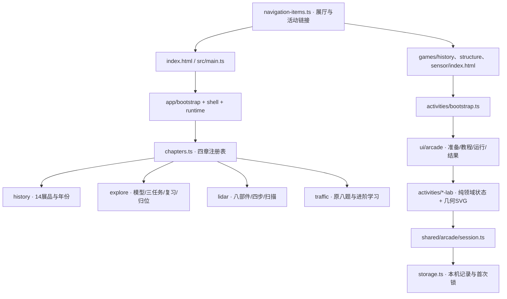

# 智驾博物馆：当前架构

更新于2026-11-08。四个展厅保留，01–03新增学习改为三个独立HTML活动；[本轮验收记录](docs/engineering/science-activities-ui-verification.md)记录实际验证与边界。

## 入口与运行

Vite显式构建四HTML入口。原展厅使用hash导航与按需Three场景；三个游戏不挂载旧章节、不请求GLB/DAE，不经过旧SPA路由。公共链接尊重Vite BASE_URL。

## 文件职责

| 位置 | 职责 |
| --- | --- |
| `src/app/chapters.ts` | 原四章注册表、动态加载 |
| `src/app/runtime.ts`、`navigation.ts` | 原章节激活、暂停、重试、返回 |
| `src/app/navigation-items.ts`、`src/ui/chapter-navigation.ts` | 展厅/独立活动共享导航元数据 |
| `src/activities/bootstrap.ts` | 独立页页头、导航、可见性、pagehide/BFCache接线 |
| `src/activities/{history,structure,sensor}-lab/main.ts` | 启动与HMR清理 |
| 各活动 `source.ts` | 只读旧纯内容适配，不导入旧controller/Three |
| 各活动 `content.ts`、`state.ts` | 内容合同、操作规则与唯一进度 |
| 各活动 `controller.ts`、`view.ts`、`graphics.ts`、`styles.css` | 稳定DOM、几何台面、输入与局部反馈 |
| 各活动 `transaction.ts` 或 `commit.ts` | 计算候选，session接受后才提交state |
| `src/ui/arcade/shell.ts` | 准备、明确开始、计时、暂停、历史、结果与作品查看 |
| `src/ui/arcade/tutorial.ts`、`sound.ts` | 不计分接线演练、默认关闭的短确认音 |
| `src/ui/arcade/pointer-drag.ts`、`selection.ts` | 纯选择及拖动预览/取消，不判答案 |
| `src/shared/arcade/types.ts`、`scoring.ts`、`challenge-code.ts` | 合同、权重计分、比较键与确定种子 |
| `src/shared/arcade/session.ts` | 正式预算、首次有效提交、目标锁、单次终局 |
| `src/shared/arcade/storage.ts` | 配置校验、草稿、锁、记录、保留与跨窗口所有权 |

领域只产出事实 `objectiveId/revision/verdict/usedHint`，不直接写分数。每次操作包括无评分的编辑均经过 `session.record(facts)`；被拒绝时领域保留原状态。会话通知延后到微任务，让最后一步状态先提交。全目标完成自动结算，成果保留在只读的“查看我的操作成果”。

练习时间/分数为null。正式360000ms，完成700/首次正确200/效率100；档位改变支持与公布容差，不改变事实与权重。教程在开始前，不占正式时长。详情见[计分附录](docs/engineering/2026-11-08-science-arcade-scoring.md)。

## 原展厅与迁移

| 展厅 | 保留 | 新知识承接 |
| --- | --- | --- |
| 01 | `data/render/controller/view`，14展品、档案、年份定位 | history-lab；旧learning-state/view删除，learning-data保留作来源 |
| 02 | 模型/分类/聚焦/开合/灯光、mission/powerflow、review、assembly/camera-observation | structure-lab；旧13挑战state/render/controller分支撤出；共享learning-data/targets及review/assembly渲染保留 |
| 03 | data/model/scene/concept/rig/measurement/experiment/scan/interaction，八部件、四步、5–80m、720点和降级 | sensor-lab；旧learning-state/view/world/camera/weather-state删除；learning-data/learning-measurement仍被source消费 |
| 04 | 原八题与完整新学习，不改变 | 本轮无迁移 |

纯状态和内容不依赖DOM或Three。章节可以导入shared，不互导controller。原WebGL章节通过setActive停止后台绘制，dispose释放请求、监听和GPU资源。旧driving目录仍未注册。

## 生命周期和本机记录

- 准备与教程不调用start。只有start成功后才创建新领域controller，重玩失败保留旧成果。
- 普通隐藏或暂停只停操作/动画，正式时钟继续；pagehide含BFCache则中断，返回准备页。
- 打开第二页只报告未结束局；显式结束操作按expectedRunId核对，不自动清理其他窗口。
- 本机键 `science-arcade:local:v1`，30天/最多200结果与200正式锁。删单条不解锁；清全部需明确二次操作，保留偏好；重置才清偏好。
- 损坏/未来schema保留原数据只读；配额/禁用退内存，显示实际未保存。开放理由只留当前页内存。
- localStorage没有原子事务，不能提供恶意并发作弊防护；此项目无账号、服务器或跨设备排行榜。

## 检查

`npm run check`串行运行unit、TypeScript/四入口构建、生产Chrome E2E。规则在tests/unit；三游戏流程、触屏、尺寸、缓存/多标签/存储故障与原展厅回归在tests/e2e。根兼容入口与资源释放测试保留。不要并行构建同一dist或争用4173。

修改入口见[内容地图](docs/engineering/content-editing-guide.md)。旧[翻新前架构](docs/architecture/2026-11-08-before-refactor.md)仅供历史对照。
