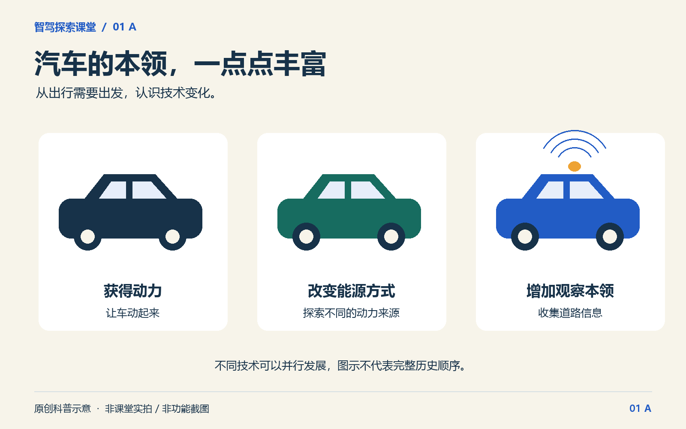
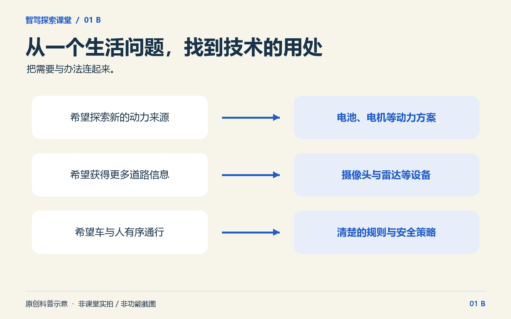
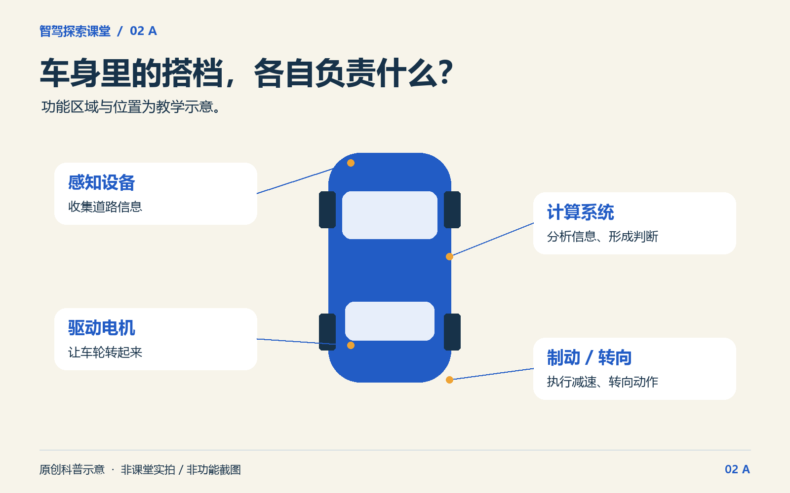
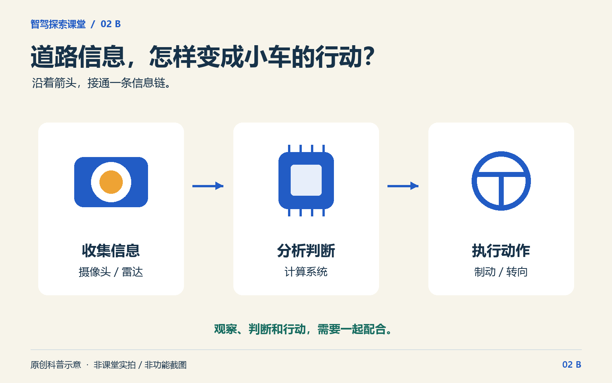
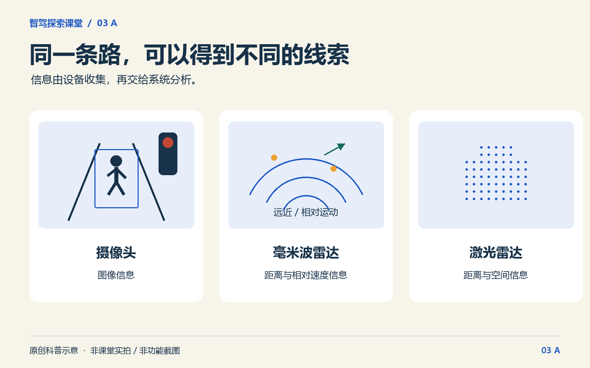
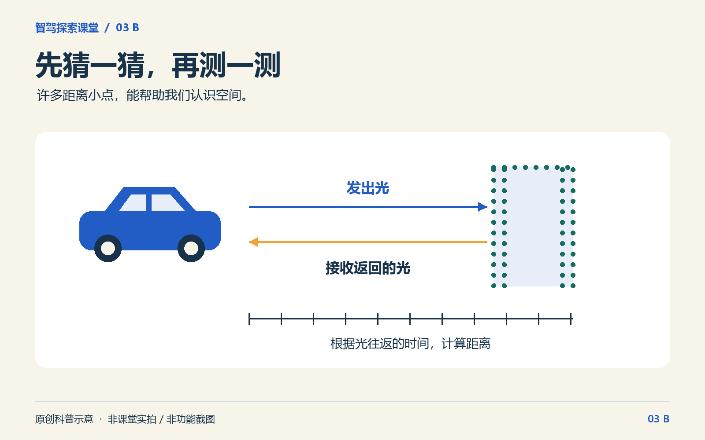
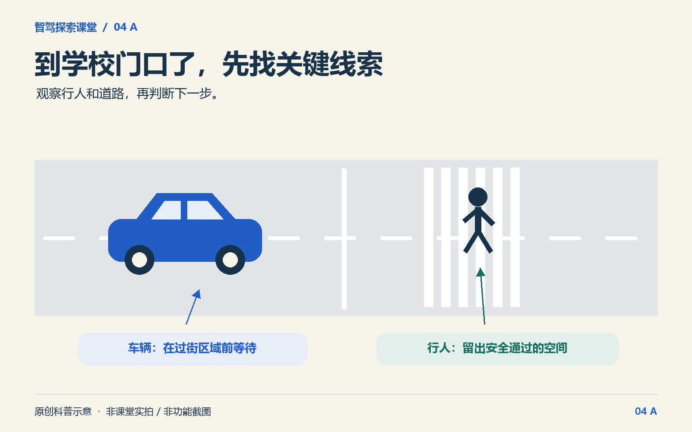
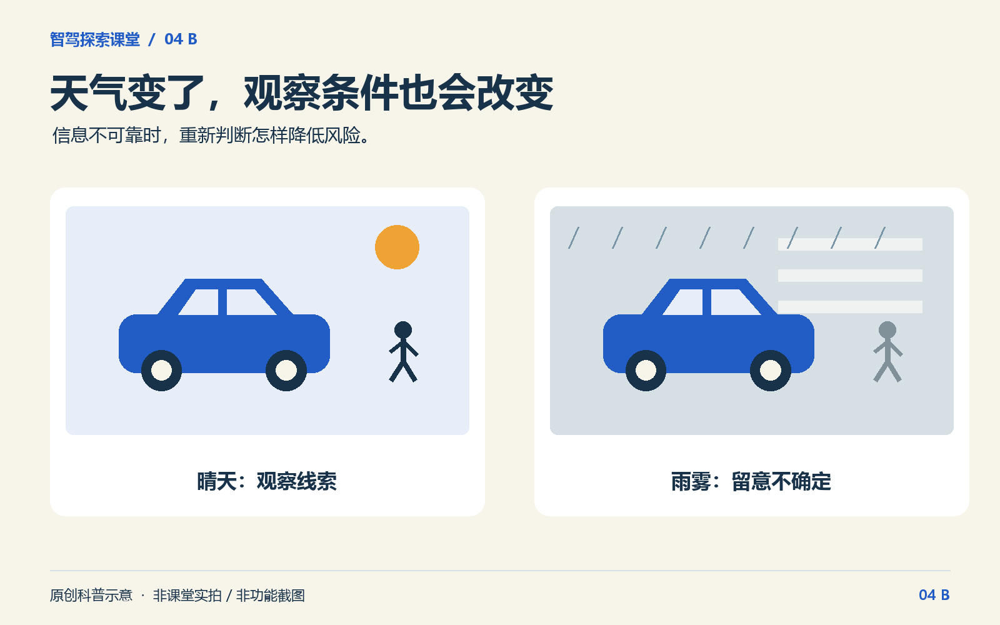
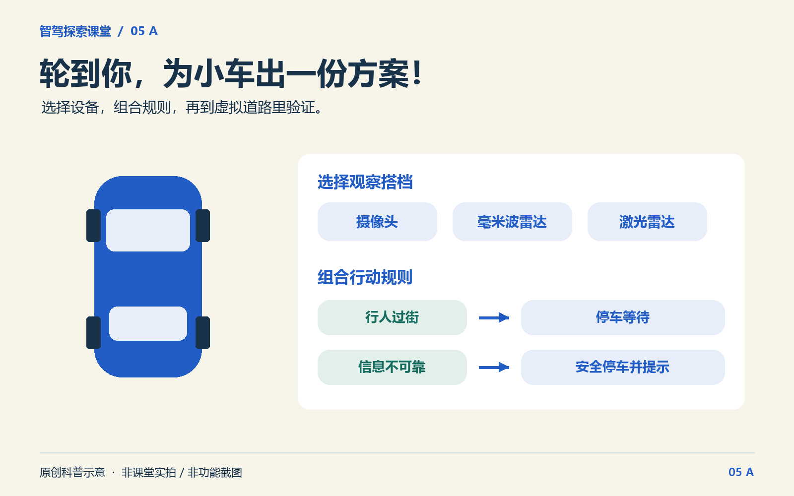
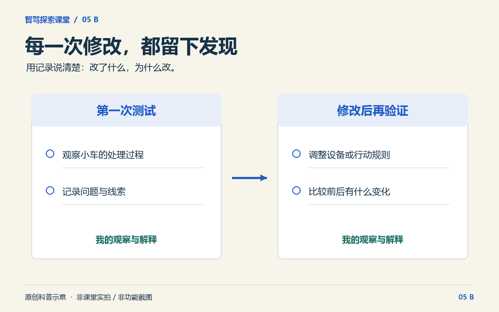

# 招募｜汽车怎么“看见”你？来当一次智能小车设计师！

> 编辑说明：以下为拟开课程的招生文案。配图均为原创科普示意，不是课堂实拍或已上线功能截图；按图注使用。活动时间、地点、费用、报名方式待主办方补齐后发布。“电子学习报告”需纳入最终课程交付。

## 备选标题

1. 招募｜汽车怎么“看见”你？来当一次智能小车设计师！【推荐】
2. 红灯停，行人让……这些本领，小车跟谁学？
3. 给小车装上“观察力”！一场能亲手设计的智驾探索课
4. 小车遇到难题，轮到你出主意！智驾探索课堂招募中
5. 未来城市怎么走？先帮这辆小车过好学校门口！

## 汽车怎么“看见”你？秘密，等你亲手找！

走到斑马线前，小车怎么知道有人要过马路？
遇到红灯，它靠什么判断该停下来？
要是突然下起大雨，前面看不清了，它又该怎么办？

这些藏在日常出行里的问题，这次交给小朋友来研究！

【展览馆名称】将从孩子熟悉的城市道路出发，把汽车里的科技变成看得见、能操作、可以亲手验证的探索活动，推出 **“智驾探索课堂”**。

**2.5 小时，每人一台电脑。**小朋友将走进汽车的“身体”，认识帮它收集信息的“观察搭档”，再为屏幕里的校园小车制定行动规则：发现行人怎么办？看不清时怎么办？

最有意思的一步留在后面：**亲自设计，亲自测试，再把发现的问题改一改！**

课程结束时，孩子将留下自己的小车设计与测试记录，生成一份电子学习报告。里面既有“我做了什么”，也有“我为什么这样改”——让好奇心变成一份能讲给爸爸妈妈听的作品。

## 01 翻开档案，追一追汽车的成长

今天路上的汽车，有的用电行驶，有的还能帮助驾驶员观察路况。这些变化，是怎么一步步发生的？

先来整理一份汽车成长档案！给技术事件排排队，把生活中的问题与相应的技术连起来：想让出行更方便，需要哪些新办法？道路越来越热闹，汽车又需要增加什么本领？

**动手找一找：每一次变化，正在回应谁的需要？**

原来，科技的故事，就藏在我们每天经过的道路上。

*配图 A：汽车本领，怎样一步步丰富？科普示意，不作为完整汽车史时间线。*

*配图 B：从生活中的需要出发，寻找技术的用处。*

## 02 打开车身，寻找幕后搭档

一辆小车能动起来、停下来，背后可不只有一个“大功臣”。

电池储存电能，电机带动车轮，制动部件帮助减速停车……还有一些搭档，负责收集道路信息、分析情况，把行动指令传下去。

在平面汽车图上，小朋友将根据提示找部件，再把 **“收集信息—分析判断—执行动作”** 接起来。连接之后，看看信息怎样一路传递到小车的行动中。

**车身里的一次默契配合，等你亲手接通！**

*配图 A：找一找，这些搭档各自负责什么？功能位置仅作教学示意。*

*配图 B：道路上的一个变化，怎样变成小车的一次行动？*

## 03 借双“慧眼”，发现道路线索

汽车怎样知道前面有什么？来认识它的几位“观察搭档”！

摄像头收集图像，帮助系统判断路上的灯和目标；雷达可以提供距离等信息；激光雷达还能把测到的空间信息画成许多小点，拼出周围的轮廓。

切换观察方式，同一条道路会变成什么样？先猜一猜哪个目标更近，再用测量结果验证。天气从晴天变成雨天、雾天，信息又会出现哪些变化？

**像小侦探一样，先提出猜想，再用线索说话。**你还会发现：设备各有本领，也各有需要注意的地方。

*配图 A：同一条路，不同设备提供的线索各不相同。图示为简化的信息示意。*

*配图 B：许多距离小点，可以组成什么轮廓？扫描路径为简化示意。*

## 04 读懂路况，给小车出主意

观察到了线索，接下来该怎么行动？

行人正在过街，信号灯变了，前方的信息不可靠……小朋友将观察屏幕里的道路，找出影响通行的关键线索，为小车选择合适的行动，再看看结果和原因。

还有一份特别的“诊断任务”：小车已经发现行人，却没有找到对应的处理规则。问题出在哪里？该补上哪一步？

**查记录、找原因、改规则，再试一次！**课堂还将穿插短小的知识竞答，和同伴比一比谁观察得仔细，交流各自的判断理由。

这一次，我们一起研究：小车怎样处理风险，才能更好地照顾道路上的人。

*配图 A：先观察斑马线上的人，再决定小车的行动。*

*配图 B：看不清时，需要重新判断。天气影响为定性教学示意。*

## 05 亲手设计，把发现变成作品

现在，轮到你为校园小车出一份方案！

选一选观察设备，配一配行动规则，再把方案放进虚拟道路里，试试它能不能处理行人、信号灯和看不清的情况。

第一次测试发现了问题？正好，带着记录回去改一改！小朋友将比较修改前后的结果，尝试说明：**“我把什么改了？为什么改？结果有什么变化？”**

最后，把自己的小车方案和测试记录整理成电子学习报告，和同伴交流，也把这段探索讲给爸爸妈妈听。

从一辆小车出发，孩子开始思考车与人、车与道路怎样相处。这也正是未来智慧交通需要面对的问题。

*配图 A：设备怎样配合，规则怎样设置？动手提出你的方案。*

*配图 B：留下发现与修改的过程，形成自己的学习记录。非学生真实成绩。*

## 带着好奇心来，带着自己的发现回去

不需要编程基础。课程将提供操作示范、图示和提示，让孩子从熟悉的生活问题开始，在观察和尝试中认识智能驾驶。

对小朋友来说，这是一段可以自己动手、给小车出主意的探索；对家长来说，值得期待的是孩子能把“我觉得”变成“我试过，我发现”：观察信息，说明理由，遇到问题后愿意调整，再验证一次。

**这次，来为未来的小车出个好主意吧！**

- **适合对象：**小学三至六年级，零基础可参加
- **课程时长：**约 2.5 小时，含休息
- **活动规模：**36 人，每人一台电脑
- **活动形式：**电脑端科普探索、知识竞答与虚拟方案实验
- **活动时间：**【待填写】
- **活动地点：**【待填写】
- **活动费用：**【待填写】
- **报名方式：**【待填写报名入口或放置二维码】

点击【报名入口】，一起开启智驾探索！

---

## 给编辑的素材选用说明（不随正文发布）

- 每个板块 A/B 两图可择一，也可同时使用；正文五个板块共十张 PNG，均为 1600×1000，适合手机端推文排版。
- 所有图片为原创平面科普图，不是实际软件截图，不展示真实学生、真实课堂或真实测试成绩。图注里的“示意”建议保留，发布时可统一放在图下。
- 如补充 GIF，优先取最终软件的真实录屏：02 信息连接后流动；03 距离揭示与点云；04 改规则再运行；05 首测与复测记录。每段建议 3—6 秒。当前素材包未包含 GIF，不能将拟议动画描述成已拍摄。
- 如补充课堂照片，可选教师示范、孩子独立操作、两人交流三类；使用真实已授权照片，避免照片暗示存在实体汽车制作或道路实车驾驶环节。
- 不使用“真人无人车接送”“实车试驾”“组装小车带回家”“机器人空降”“证书/实物礼品赠送”等尚未确认的承诺。
- 发布前确认：课程功能与电子报告可实际交付；主办方名称、日期、地点、费用、报名链接已填写；36 人规模与电脑条件可落实。
